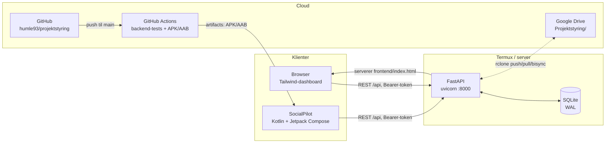
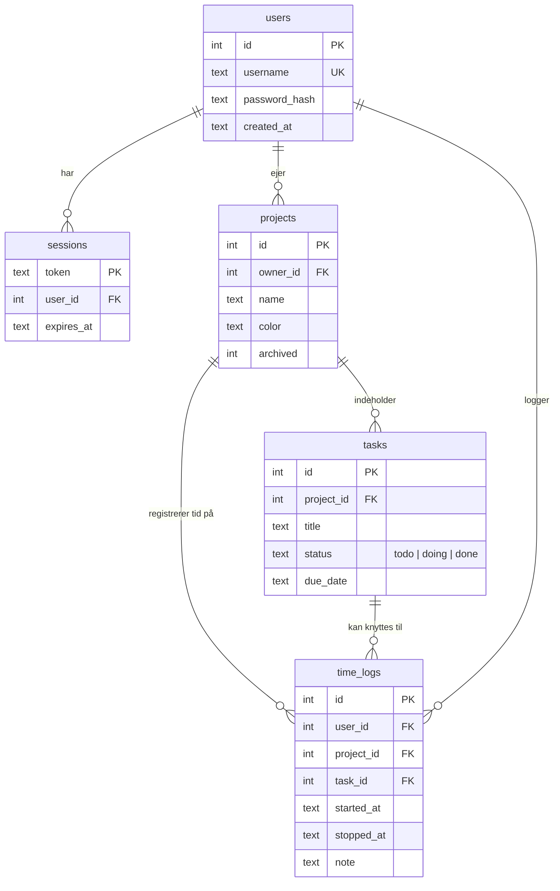
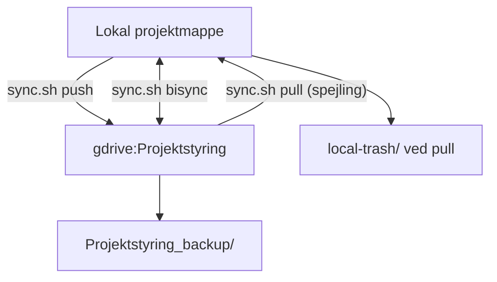

# Arkitektur — Projektstyring

Dokumentet beskriver den samlede arkitektur for Fase 1–3: infrastruktur, backend, web-dashboard,
Android-app og CI/CD. API-detaljer findes i [api-spec.md](api-spec.md).

## 1. Komponentoversigt

| Komponent | Ansvar | Teknologi |
|---|---|---|
| `frontend/index.html` | Dashboard, login, opgavetavle, live timere | Tailwind (CDN), vanilla JS |
| `backend/app/main.py` | REST-API, forretningslogik, statistik | FastAPI, Pydantic |
| `backend/app/auth.py` | Passwords (PBKDF2) og sessioner | stdlib `hashlib`, `secrets` |
| `backend/app/db.py` | Skema og forbindelser | `sqlite3`, WAL |
| `android/` | Mobil klient mod samme API | Kotlin, Compose, `HttpURLConnection` |
| `scripts/sync.sh` | Backup/synkronisering til Drive | rclone |
| `.github/workflows/` | Tests og app-builds | GitHub Actions |

## 2. Datamodel

Alt ejerskab er scoped til `user_id`: hver forespørgsel på projekter, opgaver og tidslogs filtrerer
på den indloggede bruger, så to konti ikke kan se hinandens data.

## 3. Autentificering og sessioner

1. Første besøg: `GET /api/auth/setup` returnerer `needs_setup: true`, og dashboardet viser "Opret konto".
2. `POST /api/auth/register` opretter brugeren og returnerer et sessionstoken. Derefter er registrering
   lukket, medmindre `PS_ALLOW_REGISTER=1`.
3. Adgangskoder hashes med PBKDF2-HMAC-SHA256 (260.000 iterationer, 16-byte salt) — ingen native
   bcrypt-afhængighed, hvilket er vigtigt i Termux.
4. Sessioner ligger i `sessions` med udløb (`PS_SESSION_DAYS`, standard 30 dage). Klienten sender
   `Authorization: Bearer <token>`; udløbne eller ukendte tokens giver `401`.
5. Log ud sletter sessionen server-side (`POST /api/auth/logout`).

## 4. Timer-flow

- Der kan kun være én aktiv timer pr. bruger. Start af en ny timer stopper automatisk den forrige.
- `started_at` sættes af serveren; klienten korrigerer for ur-forskel via `server_time` i svaret, så
  nedtællingen er ens på web og telefon.
- Start på en opgave i `todo` flytter den til `doing`.
- Stop sætter `stopped_at`; varighed beregnes som forskel mellem de to tidsstempler, så en genstartet
  klient ikke mister tid.

## 5. Synkronisering og backup (Fase 1)

- `check` svarer til `rclone lsd gdrive:Projektstyring` og fejler tydeligt ved manglende auth/netværk.
- `push`/`pull` er envejs spejling; overskrevne filer havner i backup-mapper, så de kan gendannes.
- `bisync` kræver `--resync` første gang og bruges til reel tovejs-synkronisering.
- Lås (`flock`) forhindrer samtidige kørsler; gentagelser sker med eksponentiel pause.
- `.git`, `node_modules`, `__pycache__` og `*.tmp` udelades.
- **SQLite-filen synkroniseres ikke levende.** WAL-filen er ikke konsistent under skrivning; tag en
  kopi med `sqlite3 projektstyring.db ".backup backup.db"` og synk den i stedet.

## 6. Drift i Termux

- `backend/run.sh` starter uvicorn på `0.0.0.0:8000`.
- `pkg install python python-pydantic` undgår at kompilere pydantic-core på telefonen.
- `termux-wake-lock` holder processen kørende, når skærmen slukkes.
- Adgang fra andre enheder sker på telefonens LAN-IP (`http://192.168.x.x:8000`); appen spørger
  efter server-URL ved første start.
- Skal tjenesten nås udefra, anbefales Tailscale frem for at åbne porte i routeren.

## 7. CI/CD

| Workflow | Trigger | Handling |
|---|---|---|
| `backend.yml` | push/PR med ændringer i `backend/**` | `pip install -r requirements.txt` + `pytest` |
| `android.yml` | push/PR med ændringer i `android/**` | `testDebugUnitTest assembleDebug assembleRelease bundleRelease`, upload af APK/AAB |

Release-builds signeres med debug-nøglen, indtil en rigtig keystore lægges i GitHub Secrets.
`versionCode`/`versionName` udledes af `GITHUB_RUN_NUMBER`.

## 8. Sikkerhedsnoter

- Ingen hemmeligheder i repoet; database, logs og keystores er gitignored.
- Al trafik i LAN'et er HTTP (`usesCleartextTraffic` i Android-manifestet). Brug Tailscale/VPN eller
  HTTPS-terminering, hvis trafikken skal over internettet.
- Sessionstokens opbevares i `localStorage` (web) og `SharedPreferences` (Android) — acceptabelt til
  et privat LAN-setup, men bør flyttes til sikker storage ved offentlig eksponering.
